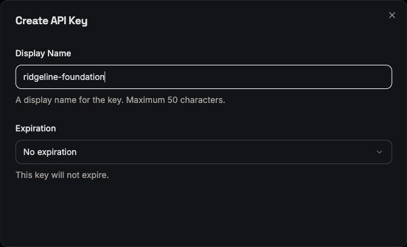
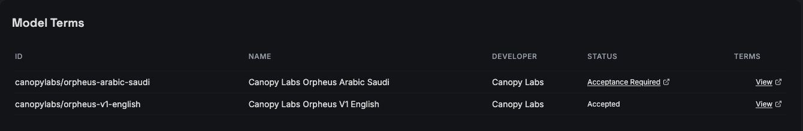
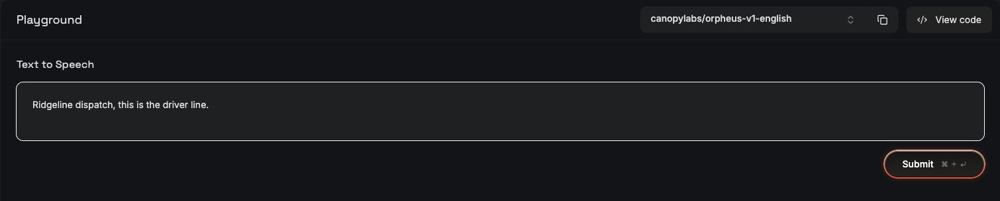

# Setup: Groq and the local TMS

[Assignment brief](README.md) · [API reference](API.md) · [Manual eval sheet](TESTING.md)

Follow this guide once before building your agent. At the end, the TMS will be running, you will have inspected a saved status update, and your laptop will have tested transcription, chat and speech through Groq.

## 1. Get the starter folder and Python

Save the supplied `starter` folder somewhere easy to find. Keep its contents together, including `.env.example`, `tms/` and `images/`. Open that folder in your editor and open its integrated terminal. All commands below run from this folder.

You need a microphone, speakers or headphones, an internet connection and Python 3.10 or newer. Python 3.12 is a suitable choice for a new installation. Download Python from [python.org](https://www.python.org/downloads/); on Windows, enable the installer's Python/PATH option. Use a normal local terminal with access to your microphone.

Check Python and your current folder:

**macOS or Linux terminal**

```sh
python3 --version
pwd
ls
```

**Windows PowerShell**

```powershell
py --version
Get-Location
Get-ChildItem -Force
```

You should see `README.md`, `SETUP.md`, `requirements.txt`, `check_setup.py` and the `tms` folder.

On Debian/Ubuntu, install the audio runtime and venv support before continuing:

```sh
sudo apt-get install python3-venv libportaudio2
```

macOS and Windows receive the PortAudio runtime with the pip package. See the [sounddevice installation guide](https://python-sounddevice.readthedocs.io/en/latest/installation.html).

## 2. Set up your Groq account and key

1. Open [GroqCloud](https://console.groq.com/). Sign up or sign in using one of the options shown, and complete any email verification or account onboarding.
2. Use the organization and project selectors at the top of the console to select your own workspace. Keep this same organization/project selected throughout setup.
3. Open [API Keys](https://console.groq.com/keys), then **Create API Key**.
4. Name the key `ridgeline-foundation` then complete creation in the dialog.
5. Copy the new secret when Groq displays it. You will paste it into your local `.env` in step 4. Keep the secret out of code, recordings and hand-ins.



_The key-name and expiration fields. Screenshot captured November 1, 2026; no new key was created for this guide. Console layout may change._

## 3. Enable speech and check your quota

Open [Settings → Model Terms](https://console.groq.com/settings/model-terms). Find **canopylabs/orpheus-v1-english**. If its status is **Acceptance Required**, follow that link, read the terms and accept them for your organization. Return to Model Terms and confirm that the English model says **Accepted**. Only English Orpheus is used in this assignment.



_The English model's Accepted status is the result to check. The Arabic model is not needed._

Open the [Orpheus playground](https://console.groq.com/playground?model=canopylabs%2Forpheus-v1-english). Check the model selector, enter `Ridgeline dispatch, this is the driver line.`, and click **Submit**. Play the generated audio. If terms are requested here, finish that step and submit again.



Open [Settings → Limits](https://console.groq.com/settings/limits) and check the allowance for the three models below. This assignment uses the quota available on your account; it does NOT require enabling paid billing. These are the models you will be using.

| Purpose                 | Exact model ID                  |
| ----------------------- | ------------------------------- |
| Transcription           | `whisper-large-v3-turbo`        |
| Chat and tool decisions | `openai/gpt-oss-20b`            |
| Speech                  | `canopylabs/orpheus-v1-english` |

For the chat call, `reasoning_effort="low"` and `max_completion_tokens=1024` are starting settings used by the setup checker; adjust them as needed.

The setup checker calls all three with your key. Playground success alone does not verify your local environment. Groq's [quickstart](https://console.groq.com/docs/quickstart) explains API keys and SDK installation; its [speech guide](https://console.groq.com/docs/text-to-speech) documents the speech endpoint.

## 4. Install dependencies and save the key

Create the environment once. These commands use its Python directly, so you do not need to activate it or change PowerShell execution policy.

**macOS or Linux**

```sh
python3 -m venv .venv
.venv/bin/python -m pip install --upgrade pip
.venv/bin/python -m pip install -r requirements.txt
cp .env.example .env
```

**Windows PowerShell**

```powershell
py -m venv .venv
.\.venv\Scripts\python.exe -m pip install --upgrade pip
.\.venv\Scripts\python.exe -m pip install -r requirements.txt
Copy-Item .env.example .env
```

Open `.env` in your editor. Replace only the key placeholder with your own secret:

```dotenv
GROQ_API_KEY=replace_with_your_groq_api_key
TMS_BASE_URL=http://127.0.0.1:8000
```

Save the file as `.env`, not `.env.txt`. Do not repeat the copy command on later sessions; it would overwrite your saved key. The setup checker reads this file automatically. Your own agent should load it too, for example with `python-dotenv`.

The starter `.gitignore` excludes `.env`, the virtual environment. Keep `.env.example` as the shareable template.

## 5. Terminal A: start the TMS

Keep one terminal open for the TMS for the entire session.

**macOS or Linux**

```sh
.venv/bin/python tms/server.py
```

**Windows PowerShell**

```powershell
.\.venv\Scripts\python.exe tms/server.py
```

Expected output:

```text
Ridgeline TMS: http://127.0.0.1:8000 (restart resets state)
```

The terminal stays occupied while the server runs. This is normal. Open these in your browser:

- [Health](http://127.0.0.1:8000/health): `{"status": "ok"}`.
- [Truck 117's driver](http://127.0.0.1:8000/v1/drivers?truck=117): Marcus Bell, driver `D117`.
- [Load RF-48213](http://127.0.0.1:8000/v1/loads/RF-48213): the delivery window and receiver facility.
- [Status updates](http://127.0.0.1:8000/v1/check-calls): initially `{"items": []}`.
- [Callbacks](http://127.0.0.1:8000/v1/callbacks): initially `{"items": []}`.

These pages display JSON. Refresh them after writes. For storage and reset behavior, see the [API reference](API.md).

## 6. Terminal B: test the voice setup

Open a second terminal in the same starter folder. Leave Terminal A running. Select your microphone and speaker in your operating system's sound settings, and allow microphone access for your terminal or editor when prompted. (Note: headphones help avoid speaker feedback.)

**macOS or Linux**

```sh
.venv/bin/python check_setup.py
```

**Windows PowerShell**

```powershell
.\.venv\Scripts\python.exe check_setup.py
```

When prompted, say **“Ridgeline dispatch, truck one seventeen.”** The checker records for three seconds, sends that audio to Groq for transcription, asks the chat model for a short reply, then generates and plays a greeting. It does not save the audio.

A successful run prints these six PASS lines, with a transcript after the transcription line:

```text
PASS TMS
PASS microphone
PASS voice detector
PASS speech to text: ...
PASS chat
PASS speech playback; confirm you heard the greeting
```

Also confirm that you actually heard the greeting. This checks setup; it is not the agent you will build.

## 7. Try a real TMS write

In Terminal B, send a sample status update. This requires no model calls.

**macOS or Linux**

```sh
curl -i http://127.0.0.1:8000/v1/loads/RF-48213/check-calls \
  -H 'Content-Type: application/json' \
  -H 'Idempotency-Key: setup-check-1' \
  -d '{"driver":"D117","location":"Denver, CO","eta":"2026-11-03T13:30:00-07:00","notes":"Setup test"}'
```

**Windows PowerShell**

```powershell
$body = @{
  driver = 'D117'
  location = 'Denver, CO'
  eta = '2026-11-03T13:30:00-07:00'
  notes = 'Setup test'
} | ConvertTo-Json
Invoke-RestMethod -Method Post `
  -Uri 'http://127.0.0.1:8000/v1/loads/RF-48213/check-calls' `
  -ContentType 'application/json' `
  -Headers @{ 'Idempotency-Key' = 'setup-check-1' } `
  -Body $body
```

Expect a record with ID `check_calls-1`. Refresh [status updates](http://127.0.0.1:8000/v1/check-calls) to see the saved location, ETA and notes. Run the same command again: it returns the same ID and leaves just one record. That is idempotency.

In Terminal A, press **Ctrl+C**, then rerun its server command. Refresh status updates: the list should be empty again. This removes the setup test before you start the assignment.

## 8. Build and run your agent

Read [API.md](API.md) and build your agent to handle driver calls through the TMS. The supplied code includes the TMS and setup checker; you write the agent.

Use the [manual eval sheet](TESTING.md) to plan and check your driver conversations.

For a Python entry point named `agent.py`, run voice mode in Terminal B:

| macOS/Linux                 | Windows PowerShell                    |
| --------------------------- | ------------------------------------- |
| `.venv/bin/python agent.py` | `.\.venv\Scripts\python.exe agent.py` |

Keep Terminal A running while you use your agent. Document your commands if you choose another entry point or language.

## 9. Finish a session and test an outage

Record your results in the eval sheet before stopping the TMS. Stop the agent and manual TMS with **Ctrl+C** in each terminal. Next session, repeat steps 5 and 8; your environment and key remain in place.

To run the assignment's outage test, stop the TMS and restart it with the flag below.

**macOS or Linux**

```sh
.venv/bin/python tms/server.py --fail-check-calls
```

**Windows PowerShell**

```powershell
.\.venv\Scripts\python.exe tms/server.py --fail-check-calls
```

New status updates now return 503; reads and callbacks still work. Restart without the flag to restore normal behavior.

## If a setup check fails

| Symptom                            | Next step                                                                                                                                        |
| ---------------------------------- | ------------------------------------------------------------------------------------------------------------------------------------------------ |
| File not found                     | Open the starter folder in both terminals; check that `tms/server.py` and `check_setup.py` are present.                                          |
| Missing Python package             | Rerun the requirements install using the same `.venv` Python used to run the checker.                                                            |
| TMS connection refused             | Start Terminal A and check the health URL.                                                                                                       |
| Port 8000 already in use           | Stop the earlier TMS instance before starting another.                                                                                           |
| Microphone silent or inaccessible  | Select the input device and allow microphone access for the terminal/editor in OS privacy settings; rerun and speak during the recording window. |
| Authentication or permission error | Check the saved key, selected Groq project, and English Orpheus's Accepted status.                                                               |
| Rate-limit error                   | Check Groq's Limits page and wait for the quota window to reset.                                                                                 |
| Playback passes but no sound       | Check the system output device and volume; rerun and listen for the greeting.                                                                    |

For audio device inspection, run your environment's Python with `-m sounddevice`. Keep the same provider and setup path while resolving the failed step.
